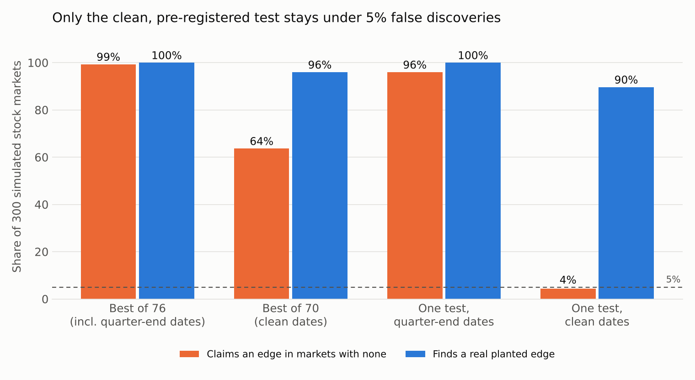
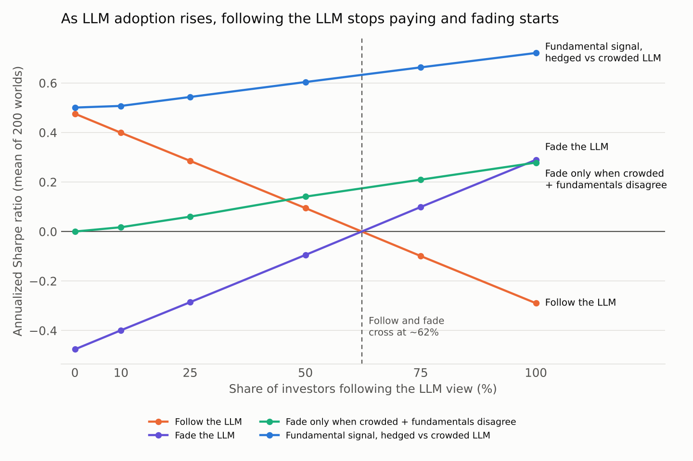

# Gedanken by Vector1

*Run the thought experiment before you risk the capital.*

**[Try Gedanken: the interactive demo](https://gedanken.vector1.ai)**

Gedanken tests market research in thousands of simulated markets where the right answer is planted in advance. It measures which methods find real edges and which ones fool themselves, then rebuilds its own methods under a judge it cannot change.

The engine is general. Each market gets a **domain pack** built from its own causal story:

| Pack | Market | Status |
| --- | --- | --- |
| Stock factors | 200 stocks, monthly returns, quarterly fundamentals reported with real-world lags | Running |
| Gas to fertilizer earnings | US and European natural gas, nitrogen fertilizer margins, producer earnings and stocks | Running |
| Power and AI data centers | Weather and data-center load, gas-set power prices, utility and power-producer earnings | Next |

Built by **Brian Curry** at [Vector1](https://vector1.ai), a non-commercial research lab. The research code, causal models and datasets are private; this repository shows the approach and the results.

*Built with Claude as an AI collaborator. Brian sets the vision, the domains, the structure and the architecture, and draws on decades of experience across domains and technologies to drive the design, the novel elements and every round of iteration and improvement. He writes the judge's rules and approves every change that goes live. Claude builds, runs and tests within them.*

> All results below come from simulated or synthetic markets with known answers. No real-market performance is claimed, and nothing here is investment advice.

## New: Gedanken Galaxy (alpha)

**[Ask the Galaxy](https://vector1.ai/demos/gedanken-galaxy/)** (also at gedanken.vector1.ai/galaxy/)

Gedanken Galaxy runs a zoo of forecasting models on public natural gas, nitrogen fertilizer, corn and food price data, stores every forecast and test in a graph, and answers plain-English questions. Its rule is **Counted Galaxy Search** (patent pending, U.S. provisional application filed November 28, 2026): every idea the Galaxy has ever examined is counted in a hash-chained ledger, and every claim must clear a bar that rises with that count, in tiers set by the causal map.

- In 1,000 simulated markets with no edge, taking the best of 114 strategies at the usual bar claimed alpha 81% of the time. Counted Galaxy Search claimed it 3% of the time and found a planted edge in 36.5% of 400 markets that had one, against 25.8% for even counting.
- On 21 years of public data, 297 ideas were scored. Tested one at a time, 93 look like edges; 11 survive, all on the nitrogen fertilizer price index (a budget-forecasting edge, not a tradable one).
- Live forecasts go into a hash-chained shadow log before the data is published.

The page reads a frozen, hashed snapshot. The engine, features and calibration are private.

## Four findings

**1. Most factor research cannot tell alpha from luck.** *(stock-factor pack)* In 300 simulated stock markets with no edge at all, a typical search that tries 76 factor variants and keeps the best claimed one 99% of the time. Two mistakes compound: trying many variants (64% on its own) and stamping fundamentals at quarter end, one to two months before investors could see them (96% on its own). One pre-registered test on data as investors saw it claimed a false edge 4% of the time and still found 90% of the real, planted edges.



**2. LLM-driven crowds flip from something to follow into something to fade.** *(gas-to-fertilizer pack)* As more investors act on the same AI-generated views, following the LLM stops paying and fading it starts to. A fundamental signal hedged against a crowded LLM view held up at every adoption level. The crossover depends on how much the crowd moves prices, so Gedanken keeps a dated daily log of LLM views to measure it live.



**3. A self-improving research system needs a judge it cannot edit.** A proposer (the Architect: a built-in library of edits, or an LLM when one is switched on) proposes one change at a time; a fixed judge (Sentinel) tests each on fresh simulated markets and accepts it only if false discoveries stay under 5% and the gain survives a correction for every attempt ever made. The first version of the judge had a little slack, and the loop found and used it immediately. A human tightened the judge; the loop then found a real improvement. In the logged runs, the built-in library proposed every change.

**4. Simulations must notice when reality leaves them.** Déjà Vu measures how far the market sits from the simulated worlds. Tested on 22 years of synthetic data with a hidden 2021 European gas shock, it raised no false alarms before the shock, caught it with a targeted check, and identified the missing driver. That finding became the next version of the causal model.

**A rule every pack must pass.** Three times, a new pack's "no edge" worlds quietly contained an edge, because something predictable was not yet in the price. Gedanken now checks every pack: in worlds with no edge, an honest test must come out near zero.

## How it works

```
Déjà Vu ──trigger──▶ Architect (proposer) ──candidate──▶ Sentinel (fixed judge)
                          ▲                               │
                          └──────── verdict + lesson ◀────┤
                                                          ▼
                     live shadow results ◀── Brian approves ── Archive + ledger
```

Ideas borrowed openly: propose-and-score search with automated evaluators (AlphaEvolve), archives of self-modifying agents (Darwin Gödel Machine), and neural-network structure: the ledger as recurrent state, credit assignment that routes each failure to the layer that caused it, and a residual path that falls back to the last version that worked.

## Chat with Brian

Vector1 is a non-commercial research lab. These are the questions Gedanken keeps circling, and Brian is happy to compare notes on any of them:

- How often does a research process fool itself, and how would you know?
- What happens to prices when millions of people ask the same AI for a view?
- How do you build AI foundations before the playbook exists, and prove they hold?

[Chat with Brian on LinkedIn](https://www.linkedin.com/in/brianjamescurry/) · [vector1.ai](https://vector1.ai) · Open source: [PyCausalSim](https://github.com/Bodhi8/pycausalsim), [Papilon](https://github.com/Bodhi8/papilon)

*Gedanken is German for "thoughts", after Einstein's thought experiments.*
